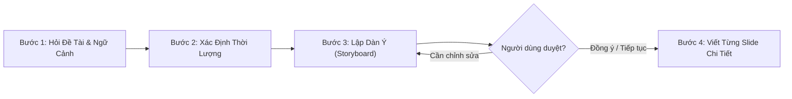

# Kỹ năng Tạo Slide Thuyết Trình Chuyên Nghiệp (`tao-slide-thuyet-trinh`)

Kỹ năng này đóng vai trò như một chuyên gia cố vấn và thiết kế bài thuyết trình (Presentation Designer & Speech Coach). Thay vì vội vã tạo một loạt slide chữ dày đặc, Agent sẽ dẫn dắt người dùng qua quy trình 4 giai đoạn chuẩn mực: **Hỏi đề tài $\rightarrow$ Xác định thời lượng $\rightarrow$ Lập dàn ý (Storyboard) $\rightarrow$ Viết chi tiết từng slide kèm ghi chú diễn giả**.

---

## Quy Trình Tương Tác 4 Bước (Interactive Workflow)



---

### Bước 1: Hỏi Đề Tài & Ngữ Cảnh (Topic & Context)

Nếu người dùng đưa ra yêu cầu còn ngắn gọn (ví dụ: *"Làm slide cho tôi về Trí tuệ nhân tạo"*), Agent **không tự ý viết ngay** mà đưa ra 1 tin nhắn ngắn gọn xác định 3 yếu tố:
1. **Đề tài & Mục tiêu chính:** Bài nói hướng tới việc truyền đạt kiến thức, báo cáo tiến độ, thuyết phục/gọi vốn (pitching), hay bảo vệ đồ án?
2. **Đối tượng người nghe (Audience):** Giảng viên hội đồng, sinh viên cùng lớp, khách hàng, hay ban giám đốc? (Mức độ am hiểu kỹ thuật của họ cao hay cơ bản?)
3. **Phong cách & Tông giọng:** Trang trọng học thuật, hiện đại công nghệ, tối giản thanh lịch, hay năng động truyền cảm hứng?

> *Nguyên tắc ngắn gọn:* Đưa ra sẵn 1-2 phương án mặc định để người dùng chỉ cần gõ "1" hoặc "Ok" nếu đồng ý, không bắt người dùng điền khảo sát dài.

---

### Bước 2: Xác Định Thời Lượng & Quy Đổi Số Lượng Slide

Quy tắc vàng của thuyết trình chuyên nghiệp: **1 slide nội dung $\approx$ 1.5 đến 2 phút trình bày**. Không nhồi nhét quá nhiều slide làm người nghe quá tải.

| Thời lượng bài nói | Số lượng slide khuyến nghị | Cấu trúc phân bổ thời gian |
| :---: | :---: | :--- |
| **3 - 5 phút** (Pitching ngắn / Báo cáo nhanh) | **3 - 5 slide** | Mở đầu (45s) $\rightarrow$ Trọng tâm/Giải pháp (3p) $\rightarrow$ Kêu gọi hành động (45s) |
| **8 - 10 phút** (Báo cáo môn học / Bài tập lớn) | **6 - 8 slide** | Đặt vấn đề (1.5p) $\rightarrow$ Nội dung/Kết quả (6p) $\rightarrow$ Kết luận & Q&A (1.5p) |
| **15 - 20 phút** (Bảo vệ đồ án / Báo cáo dự án) | **10 - 14 slide** | Mở đầu & Cơ sở (3p) $\rightarrow$ Kiến trúc/Triển khai (10p) $\rightarrow$ Đánh giá & Hướng phát triển (3p) |
| **30 - 45 phút** (Hội thảo / Đào tạo / Giảng dạy) | **18 - 25 slide** | Tổng quan (5p) $\rightarrow$ Các phần chuyên sâu (25p) $\rightarrow$ Thực hành/Tổng kết (10p) |

---

### Bước 3: Lập Dàn Ý (Storyboard) & Xin Ý Kiến Duyệt

> **Quy tắc quan trọng:** *"Sửa dàn ý trên văn bản rất nhanh; sửa một bộ slide đã viết chi tiết rất tốn công."* Luôn trình bày Storyboard và hỏi ý kiến người dùng trước khi chuyển sang Bước 4.

#### Tiêu chuẩn của một Storyboard tốt:
1. **Tiêu đề phải là một NHẬN ĐỊNH / THÔNG ĐIỆP (Action Title):**
   - *Tiêu đề kém:* "Doanh thu năm 2024"
   - *Tiêu đề chuẩn:* "Doanh thu năm 2024 tăng trưởng 35% nhờ mở rộng kênh di động"
2. **Chỉ ra dạng trực quan (Visual Type):** Biểu đồ cột, so sánh 2 cột, quy trình 3 bước, bảng số liệu, lưới 4 thẻ, hay trích dẫn nổi bật.
3. **Mỗi slide chỉ giải quyết 1 ý tưởng duy nhất.**

#### Định dạng khung Storyboard mẫu gửi người dùng:
```markdown
### Dàn ý bài thuyết trình (Storyboard)
- **Chủ đề:** [Tên chủ đề]
- **Thời lượng:** [X phút] (~ [Y slide])
- **Người nghe:** [Đối tượng]

| Slide # | Loại slide | Tiêu đề nhận định (Thông điệp chính) | Trọng tâm nội dung (Bullet points) | Bố cục trực quan đề xuất |
| :---: | :--- | :--- | :--- | :--- |
| 1 | Trang bìa | [Tên đề tài bài nói] | Họ tên, Mã lớp/Nhóm, Giảng viên hướng dẫn | Tối giản, logo trường, tên nổi bật |
| 2 | Đặt vấn đề | [Thực trạng nhức nhối hiện nay] | 2-3 số liệu hoặc thực tế bức xúc | 1 số liệu khổng lồ + 2 điểm nghẽn |
| 3 | Giải pháp | [Giải pháp đề xuất giải quyết vấn đề] | Nguyên lý hoạt động, 3 lợi thế cốt lõi | Sơ đồ 3 khối ngang hoặc thẻ icon |
| ... | ... | ... | ... | ... |
| N | Kết luận | [Kêu gọi hành động / Tóm lược giá trị] | 2 bài học then chốt, lời cảm ơn & liên hệ | Thông điệp lớn trung tâm + Thông tin Q&A |

*Bạn có muốn điều chỉnh, thêm/bớt slide nào trong dàn ý trên không? Nếu đã ưng ý, mình sẽ tiến hành viết chi tiết từng slide nhé!*
```

---

### Bước 4: Viết Từng Slide Chi Tiết

Sau khi người dùng đồng ý với dàn ý, viết chi tiết từng slide theo đúng cấu trúc tiêu chuẩn:

Mỗi slide gồm 4 phần:
1. **Số & Tiêu đề slide:** Tiêu đề nhận định rõ ràng.
2. **Bố cục hiển thị (Slide Content):**
   - Áp dụng nguyên tắc **6x6**: Tối đa 6 dòng, mỗi dòng tối đa 6-8 từ.
   - Viết câu súc tích, gạch đầu dòng song song ngữ pháp, in đậm từ khóa cốt lõi.
3. **Gợi ý thiết kế trực quan (Visual & Layout Notes):** Gợi ý màu sắc, vị trí đặt ảnh/biểu đồ, kiểu icon phù hợp.
4. **Ghi chú diễn giả (Speaker Notes):** Đoạn văn tự nhiên giúp người thuyết trình biết chính xác nên nói gì, nhấn giọng ở đâu, và cách nối tiếp mượt mà sang slide kế tiếp.

---

## Kho Mẫu Slide Hoàn Chỉnh (Slide Templates)

### Mẫu 1: Thuyết trình Học phần / Báo cáo Đồ án Công nghệ (8 - 10 Slide)

#### Slide 1: Slide Bìa (Title Slide)
* **Tiêu đề:** XÂY DỰNG ỨNG DỤNG QUẢN LÝ CÔNG VIỆC THÔNG MINH TRÊN NỀN TẢNG ANDROID
* **Phụ đề:** Đồ án môn học: Lập trình Thiết bị Di động
* **Thông tin:**
  * Giảng viên hướng dẫn: ThS. [Họ và tên Thầy/Cô]
  * Sinh viên thực hiện: [Họ tên] - MSSV: [MSSV] - Lớp: [Mã Lớp]
* **Bố cục trực quan:** Nền sáng/tối tối giản, logo trường góc trái trên, tên đề tài in hoa cỡ lớn, căn lề trang trọng.
* **Speaker Notes:** *"Kính chào Thầy/Cô và các bạn. Hôm nay em xin đại diện nhóm trình bày về đồ án xây dựng ứng dụng Task Manager trên nền tảng Android, một giải pháp giúp người dùng tối ưu hóa hiệu suất làm việc cá nhân hàng ngày."*

#### Slide 2: Vấn đề Thực tế (The Problem)
* **Tiêu đề nhận định:** 70% người dùng trẻ gặp tình trạng quá tải thông tin và trì hoãn công việc
* **Nội dung slide:**
  * **Phân mảnh công việc:** Ghi chú rải rác trên giấy, tin nhắn chat và email.
  * **Thiếu cơ chế nhắc nhở thông minh:** Các app hiện tại quá phức tạp hoặc thiếu tính năng nhắc việc theo vị trí.
  * **Tỷ lệ bỏ dở cao:** Giao diện cồng kềnh khiến 60% người dùng xóa app sau tuần đầu tiên.
* **Bố cục trực quan:** Bố cục 3 cột thẻ (cards), mỗi cột có 1 biểu tượng cảnh báo và số liệu tô đỏ nổi bật.
* **Speaker Notes:** *"Xuất phát từ thực tế, chúng em nhận thấy giới trẻ hiện nay đang bơi giữa quá nhiều tác vụ... Chúng em đặt ra câu hỏi: Làm sao để tạo ra một ứng dụng tối giản nhưng đủ thông minh để người dùng duy trì thói quen mỗi ngày?"*

#### Slide 3: Giải pháp Ứng dụng (The Solution)
* **Tiêu đề nhận định:** Ứng dụng TodoPro mang đến trải nghiệm quản lý công việc theo phương pháp Kanban và nhắc việc tự động
* **Nội dung slide:**
  * **Giao diện Modern Jetpack Compose:** Tinh gọn, thao tác kéo thả mượt mà.
  * **Đồng bộ thời gian thực:** Lưu trữ Firebase Cloud Firestore, truy cập mọi lúc mọi nơi.
  * **Thông báo thông minh (Local Push Notification):** Tự động nhắc việc trước hạn chót 15 phút.
* **Bố cục trực quan:** Ảnh mockup điện thoại hiển thị màn hình chính của ứng dụng ở giữa, hai bên là 3 mũi tên chỉ vào các tính năng đột phá.
* **Speaker Notes:** *"Và đây là câu trả lời của nhóm chúng em: TodoPro. Thay vì ôm đồm tính năng, TodoPro tập trung vào 3 giá trị cốt lõi: trực quan với Jetpack Compose, đồng bộ tức thì qua Firebase và hệ thống thông báo chính xác..."*

#### Slide 4: Kiến trúc Hệ thống (Architecture & Tech Stack)
* **Tiêu đề nhận định:** Hệ thống được xây dựng theo kiến trúc MVVM chuẩn mực từ Google
* **Nội dung slide:**
  * **UI Layer:** Jetpack Compose + Material Design 3.
  * **Domain & State Layer:** ViewModel, Kotlin Coroutines, StateFlow.
  * **Data Layer:** Room Database (Offline Cache) + Firebase REST API / Firestore.
* **Bố cục trực quan:** Sơ đồ 3 tầng hình hộp chữ nhật xếp tầng dọc (UI $\rightarrow$ ViewModel $\rightarrow$ Repository $\rightarrow$ Data Sources), mũi tên biểu thị luồng dữ liệu 1 chiều (UDF).
* **Speaker Notes:** *"Về mặt kỹ thuật, nhóm áp dụng mô hình MVVM kết hợp luồng dữ liệu một chiều Unidirectional Data Flow, giúp việc kiểm thử và mở rộng ứng dụng trong tương lai trở nên độc lập và an toàn..."*

#### Slide 5: Kết quả Đạt được & Demo (Results & Key Features)
* **Tiêu đề nhận định:** Hoàn thiện 100% các tính năng cam kết với độ ổn định cao
* **Nội dung slide:**
  * **Hiệu năng:** Khởi động ứng dụng dưới 1.2 giây, tốc độ khung hình ổn định 60fps.
  * **Đồng bộ dữ liệu:** Hoạt động liền mạch kể cả khi mất kết nối Internet (Offline-first).
  * **Bảo mật:** Xác thực người dùng qua Firebase Authentication.
* **Bố cục trực quan:** Video quay màn hình demo (GIF ngắn) hoặc lưới 2x2 ảnh chụp màn hình các chức năng chính.
* **Speaker Notes:** *"Sau 4 tuần triển khai, ứng dụng đã hoàn thiện trọn vẹn từ khâu xác thực tài khoản, thêm xóa sửa task đến chạy nền nhắc việc. Sau đây em xin phép chiếu đoạn video demo ngắn..."*

#### Slide 6: Kết luận & Hướng phát triển (Conclusion & Future Work)
* **Tiêu đề nhận định:** TodoPro sẵn sàng triển khai thực tế và mở rộng tính năng AI gợi ý công việc
* **Nội dung slide:**
  * **Bài học kinh nghiệm:** Làm chủ Jetpack Compose và kỹ năng quản lý luồng bất đồng bộ trong Kotlin.
  * **Hướng phát triển:** Tích hợp Gemini Nano để tự động phân tích và sắp xếp thứ tự ưu tiên task; mở rộng phiên bản Wear OS.
  * **Lời cảm ơn:** Nhóm xin chân thành cảm ơn Thầy [Tên GV] đã tận tình chỉ dẫn.
* **Bố cục trực quan:** Bên trái là 2 khối lộ trình tương lai (Roadmap), bên phải là thông tin liên hệ, mã QR tải app thử nghiệm và khung Q&A.
* **Speaker Notes:** *"Đồ án này không chỉ giúp chúng em hoàn thiện sản phẩm mà còn là cơ hội quý báu để rèn luyện kỹ năng công nghệ di động hiện đại. Nhóm em xin chân thành cảm ơn sự đồng hành của Thầy và sẵn sàng lắng nghe các câu hỏi đóng góp từ Hội đồng ạ."*

---

### Mẫu 2: Pitch Deck Gọi Vốn / Trình Bày Ý Tưởng Dự Án (5 - 7 Slide)

1. **Slide 1 - Hook & Mission:** Vấn đề triệu đô và sứ mệnh của giải pháp.
2. **Slide 2 - Nỗi đau thị trường (Market Pain):** Ai đang chịu thiệt hại? Thiệt hại bao nhiêu tiền/thời gian?
3. **Slide 3 - Sản phẩm & Sự khác biệt (Product & Moat):** Tại sao là chúng tôi? Lợi thế cạnh tranh không thể sao chép.
4. **Slide 4 - Tiềm năng thị trường (TAM - SAM - SOM):** Quy mô thị trường và đối tượng mục tiêu.
5. **Slide 5 - Mô hình kinh doanh & Kế hoạch doanh thu (Business Model):** Kiếm tiền từ đâu? Dự phóng 3 năm.
6. **Slide 6 - Kêu gọi (The Ask):** Số vốn cần huy động và mục đích giải ngân cụ thể.

---

## Hướng Dẫn Thiết Kế & Quy Chuẩn Tiếng Việt Trong Slide

### 1. Phông chữ an toàn (Tránh lỗi dấu Tiếng Việt)
- Phông không chân (Khuyên dùng): **Segoe UI, Arial, Calibri, Tahoma, Montserrat**
- Phông có chân (Trang trọng): **Times New Roman, Georgia, Merriweather**
- *Lưu ý:* Giãn dòng tiếng Việt tối thiểu **1.15 - 1.25** để dấu ngã, hỏi, nặng không bị chạm vào dòng trên. Không viết hoa toàn bộ đoạn văn dài vì dấu thanh sẽ bị biến dạng.

### 2. Nguyên tắc phối màu (Quy tắc 60 - 30 - 10)
- **60% Màu nền:** Màu sáng sạch (trắng, xám rất nhạt) hoặc màu tối sang trọng (xanh than, xám đen).
- **30% Màu chủ đạo:** Màu đại diện thương hiệu hoặc chủ đề (xanh dương công nghệ, xanh lá bền vững).
- **10% Màu nhấn (Accent):** Dùng để tô màu con số quan trọng, nút hành động, từ khóa then chốt (cam, vàng, đỏ son).

---

## 💾 Lưu & Xuất Tệp

Khi người dùng yêu cầu xuất file dàn ý hoặc nội dung slide:
- Định dạng xuất: Markdown `.md` hoặc văn bản `.txt`.
- Thư mục lưu mặc định: `D:\Output_skill/` (hoặc thư mục người dùng yêu cầu).
- Tên tệp quy ước: `slide_<chu_de>_<thoi_luong>p.md`.

